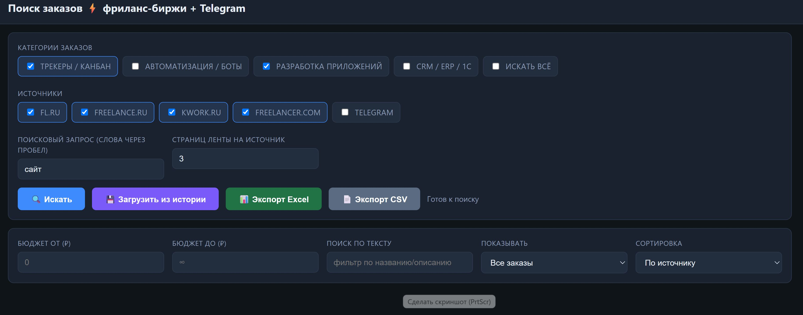

# Поиск заказов на фриланс-биржах

Веб-приложение: парсит свежие заказы с FL.ru, freelance.ru, Kwork.ru,
Freelancer.com и публичных Telegram-каналов, фильтрует по категориям,
бюджету и тексту, экспортирует результат в Excel/CSV.
.

## Возможности

- **Источники:** FL.ru, freelance.ru, Kwork.ru, Freelancer.com, Telegram
- **Категории:** трекеры/канбан, автоматизация/боты, разработка, CRM/ERP/1С
- **Фильтры:** бюджет (от/до), поиск по тексту, метки (отклик/избранное/скрыть)
- **Сортировка** и **живое переприменение** фильтров без повторного парсинга
- **История заказов** (SQLite): каждый поиск сохраняется, новые помечаются `NEW`,
  можно восстановить прошлые результаты кнопкой «Загрузить из истории»
- **Экспорт** отфильтрованного списка в Excel (.xlsx) и CSV

## Локальный запуск

```powershell
python -m pip install -r requirements.txt
python app.py
```

Откроется `http://127.0.0.1:8000`. Или двойной клик по `start.bat`.

## Деплой на Render.com (бесплатно)

1. Залейте проект в GitHub (репозиторий уже подключён).
2. Зайдите на https://render.com → **New** → **Web Service**.
3. Подключите GitHub-репозиторий `VK-Bot-Rozi`.
4. Render подхватит `render.yaml`. Если нет — задайте вручную:
   - **Runtime:** Python
   - **Build Command:** `pip install -r requirements.txt`
   - **Start Command:** `gunicorn app:app --bind 0.0.0.0:$PORT --workers 1 --threads 8 --timeout 300`
   - **Plan:** Free
5. Нажмите **Create Web Service**. Через пару минут получите ссылку вида
   `https://poisk-zakaza.onrender.com`.

> Бесплатный тариф Render «засыпает» после 15 минут простоя: первый
> запрос после паузы грузится ~30–60 секунд.

## Деплой на Railway.app

Railway читает `Procfile` и `railway.json` из корня проекта.

1. Откройте https://railway.com/new → **Deploy from GitHub repo**.
2. Выберите репозиторий `VK-Bot-Rozi`.
3. Railway сам поставит зависимости (`requirements.txt`) и запустит
   `gunicorn` согласно `Procfile` / `railway.json`.
4. Для постоянной истории: **New → Database → Add PostgreSQL** в том же
   проекте — Railway сам прокидывает `DATABASE_URL` в сервис.
5. Во вкладке **Settings → Networking** нажмите **Generate Domain**,
   чтобы получить публичную ссылку.

> У Railway нет постоянно-бесплатного плана: даётся разовый trial-кредит,
> далее оплата (~$5/мес). Зато сервис не «засыпает».

## Деплой на Amvera Cloud (РФ, есть бесплатный тариф)

Amvera читает `amvera.yml` из корня проекта. Деплой идёт через свой git-remote.

1. Создайте аккаунт на https://cloud.amvera.ru и нажмите **Создать** →
   тип «Приложение».
2. На этапе «Загрузка данных» выберите подключение к существующему
   GitHub-репозиторию **или** используйте git-remote Amvera.
3. Через git-remote:
   ```powershell
   & "C:\Program Files\Git\cmd\git.exe" remote add amvera https://git.amvera.ru/<логин>/<проект>
   & "C:\Program Files\Git\cmd\git.exe" push amvera main:master
   ```
4. Дождитесь статуса «Успешно развернуто». Публичный адрес —
   `https://<проект>-<логин>.amvera.io`.

> Конфигурация в `amvera.yml`: Python 3.12, pip, gunicorn на порту 80
> (`containerPort: 80`), постоянное хранилище `/data`.

## История заказов (SQLite)

Каждый поиск сохраняется в базу:
- **PostgreSQL** — если задана переменная `DATABASE_URL` (рекомендуется для
  Render/Railway: диск там эфемерный, а БД переживает пересборки);
- **SQLite** — по умолчанию: `/data/orders.db` на Amvera (постоянное хранилище,
  не затирается при пересборке), либо `data/orders.db` локально.

Бэкенд выбирается автоматически, менять код не нужно. Схема создаётся при старте.
`render.yaml` уже провижнит бесплатную БД и прокидывает `DATABASE_URL` в сервис.

Новые (ранее не встречавшиеся) заказы помечаются меткой **NEW**, их можно
отфильтровать в поле «Показывать → Только новые в истории». Кнопка
**«Загрузить из истории»** восстанавливает последние найденные заказы
без повторного парсинга. Сброс — `POST /api/history/clear`.

## Переменные окружения

| Переменная     | Назначение                                  |
|----------------|---------------------------------------------|
| `PORT`         | порт (на Render задаётся автоматически)     |
| `DATABASE_URL` | строка подключения PostgreSQL (иначе SQLite) |
| `APP_PASSWORD` | пароль для входа (пусто = без пароля)       |
| `APP_USER`     | логин для входа (по умолчанию `admin`)      |
| `TG_PROXY`     | прокси для Telegram, напр. `socks5h://...`  |
| `PYTHONIOENCODING` | `utf-8` (корректный вывод юникода)      |

## Защита паролем

Если задать `APP_PASSWORD`, всё приложение закрывается HTTP Basic Auth
(браузер спросит логин/пароль). Логин по умолчанию `admin`, меняется через
`APP_USER`. Без `APP_PASSWORD` приложение открыто всем.

## Telegram

Каналы читаются через веб-превью `https://t.me/s/<канал>`. Если провайдер
блокирует `t.me`, задайте `TG_PROXY`. Список каналов — в `parser_freelance.py`
(переменная `TG_CHANNELS`).

## Файлы

- `app.py` — Flask-приложение: HTML-интерфейс, API поиска и экспорта
- `parser_freelance.py` — парсеры источников, матчеры и категории
- `storage.py` — хранилище истории: PostgreSQL (`DATABASE_URL`) или SQLite
- `start.bat` — локальный запуск в один клик
- `requirements.txt` — зависимости (Flask, gunicorn, requests, bs4, openpyxl)
- `render.yaml` — конфигурация деплоя на Render
- `Procfile` / `railway.json` — конфигурация деплоя на Railway
- `amvera.yml` — конфигурация деплоя на Amvera Cloud
- `runtime.txt` — версия Python
